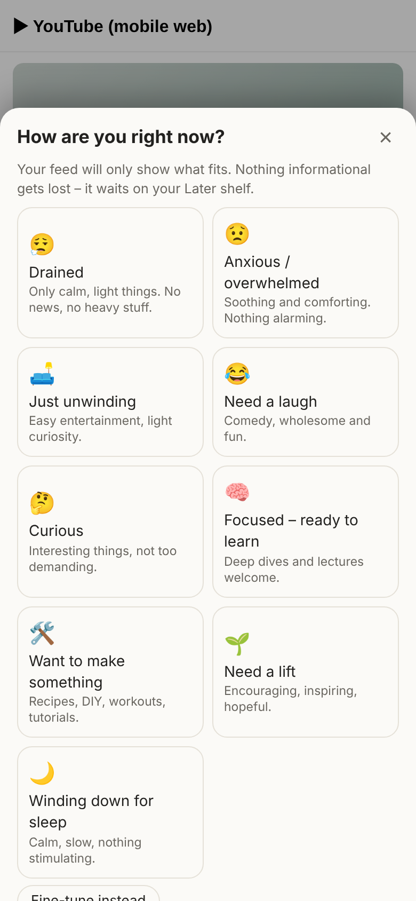
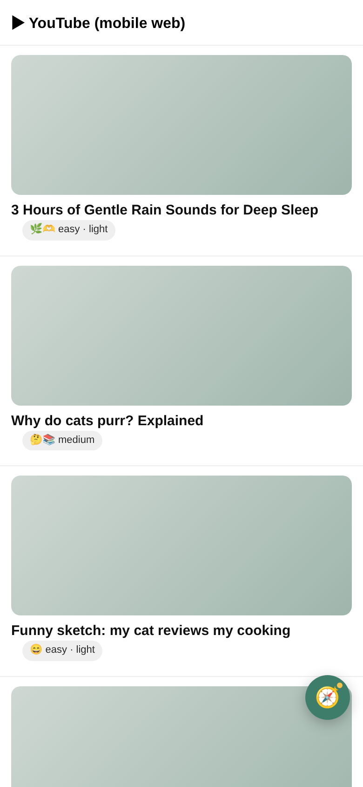
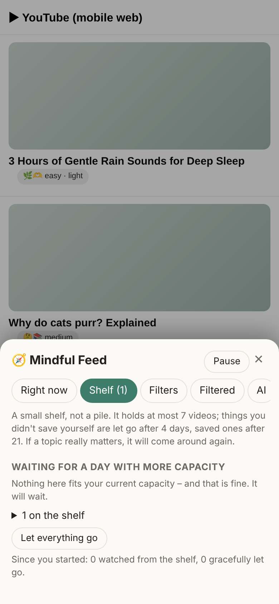
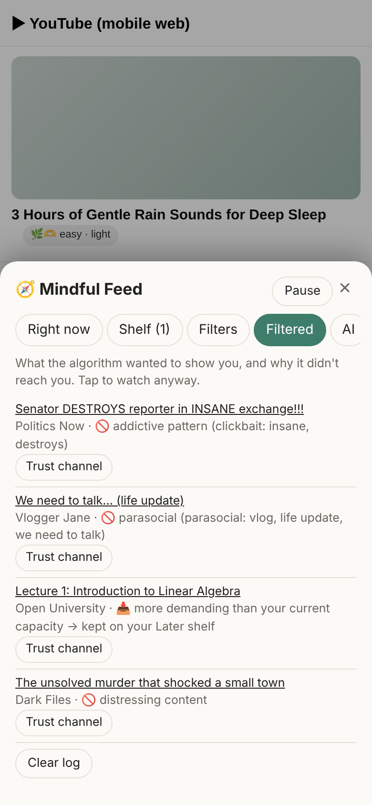

# Mindful Feed – a YouTube feed that respects your mental state

Mindful Feed is an Android app (plus a userscript) that sits between you and
YouTube. It **keeps YouTube's own recommendations**, which are still based on
your account and history, and only lets through what fits **how you feel right now**.

<p>




</p>

## Why

Before building this I looked for an existing app. Nothing does all of it:

| Existing tool | What it does | What's missing |
|---|---|---|
| Wallhabit, AppBlock, ScrollGuard, AwayDoomscrollin' | Block Shorts / sections of the YouTube app | No content judgement, no mood |
| Unhook, ReVanced patches, NewPipe | Hide related videos, comments, Shorts | No psychological filtering. ReVanced Extended was archived in 2026 |
| SanityTV, AlgoGuardian, FocusTube, Detoxify (browser extensions) | Filter clickbait / off-goal videos with AI | Desktop or Firefox only, not mood-based |
| UP – Scroll Happy | Mood-ranked videos | Its own platform, not YouTube |

None of them shapes the YouTube feed around **psychological needs, cognitive
load, tone and politics**. None of them solves the *Watch Later guilt pile* either.

## What it does

**1. Check-in: "How are you right now?"** (every few hours, or any time via 🧭)

| Preset | Feed shows |
|---|---|
| 😮‍💨 Drained | only calm, light, low-effort videos |
| 😟 Anxious / overwhelmed | soothing, comforting; nothing alarming |
| 🛋️ Just unwinding | easy entertainment and light curiosity |
| 😂 Need a laugh | comedy, wholesome, fun |
| 🤔 Curious | interesting, not too demanding |
| 🧠 Focused | deep dives, lectures; politics/news allowed |
| 🛠️ Want to make something | recipes, DIY, workouts, tutorials |
| 🌱 Need a lift | inspiring, hopeful |
| 🌙 Winding down for sleep | calm, slow, nothing stimulating |

Everything can be fine-tuned:

- **need**: relaxation · laughter · light curiosity · learning · doing/making · inspiration · comfort
- **mental capacity**: relaxed / in-between / strenuous
- **tone**: light-hearted / balanced / anything
- **politics**: apolitical / political ok
- **news**: on / off
- **distressing topics** (crime, war, disasters, horror): on / off

**2. Protections** (on by default)

- **Parasocial** content is hidden: vlogs, life updates, drama, call-outs, reactions, "we need to talk", stream VODs.
- **Addictive** patterns are hidden: clickbait, rage bait, ALL CAPS!!!, challenges, pranks, "wait for it".
- **Shorts** are gone from the feed and from the bottom bar.
- **No recommendations while watching.** The related videos under the player
  and the suggestions near comments are removed, along with end screens, info
  cards and autoplay of the next video. Playlists you chose yourself stay.

**3. Topics, channels, keywords**: only-these topics, never-these topics,
blocked keywords and channels, and trusted channels that always show.

**4. The Later shelf, so you don't need the Watch Later pile**

Informational videos are the ones that pile up in Watch Later. You only have
room for one at a time, the rest sit there, and they nag you. Mindful Feed
handles them differently:

- You get an **informational budget** (default: 1 per day, or per session).
  Once it's used, other informational videos don't disappear. They go on the shelf.
- When you're tired or in a "relax" mood, informational videos are **caught
  for later** instead of being shown.
- The shelf is **small and lets things go on its own**. It holds 7 at most.
  Auto-caught items leave after 4 days and items you saved leave after 21.
  It says so openly: *"If a topic really matters, it will come around again."*
- It shows **one thing, when you are ready**: a single next video that fits
  your current capacity, not a list.
- A **＋ Later shelf** chip on every video replaces Watch Later.

**5. Transparency.** The *Filtered* tab lists every video the algorithm wanted
to show you and why it didn't. Tap one to watch it anyway, or trust its channel.
Optional labels on each video show what it is (🌿 easy · light, 📚 demanding …).

## How it works

```
YouTube's own response (ytInitialData, /youtubei/v1/browse|next|player)
        │  intercepted before the page renders it
        ▼
core/extractor.js   finds every video item in any renderer shape
core/classifier.js  → needs, cognitive load, tone, political, news,
                       distressing, parasocial, addictive, topics
core/policy.js      → show / hide / put on shelf, given your current state
        │
        ▼
page renders only what passed  +  core/curator.js DOM safety net & UI
```

- **The algorithm still does the picking.** It filters what YouTube already
  chose for you, so the feed stays personal. It only removes items.
- **Two layers.** Filtering on the JSON avoids flicker. A DOM layer catches
  anything that slipped through after YouTube changed its markup.
- **Offline and private by default.** Classification uses transparent keyword
  rules (English + German) that run on the device. There's no tracking and no
  server, and all settings stay on your phone.
- **Optional AI.** In the Android app you can add your own Anthropic API key
  (🧭 → AI). Claude then labels each video more accurately. Only the title,
  channel, duration and a short text snippet are sent, and each video is
  classified once and cached. The default model is Claude Opus 5.5 (most
  accurate). Sonnet 5.5 and Haiku 5.5 are cheaper options. Server-side refusal
  fallback is enabled for the Opus and Sonnet models.

## Install

### Android app (APK)

1. Open the latest successful run under **Actions → Build** in this repository.
   Download the `MindfulFeed-apk` artifact and unzip it. Or take
   `MindfulFeed.apk` from **Releases**, if one has been tagged.
2. Install it. Android will ask you to allow installs from your browser or file manager.
3. Sign in to YouTube inside the app so the feed is *yours*.
4. Optional: long-press a YouTube link → *Open with* → Mindful Feed, or share
   a link to it. Videos then open without the official app's recommendations.

The CI build is signed with a debug key so it can be sideloaded. It is not meant
for the Play Store.

### Userscript (any browser that supports Tampermonkey/Violentmonkey)

Install [`dist/mindful-feed.user.js`](dist/mindful-feed.user.js). It works on
`m.youtube.com` and `www.youtube.com`, including Firefox for Android. AI
classification isn't available in the userscript.

## Known limitations

- **It wraps the YouTube website, not the official app.** Background playback,
  downloads and other YouTube Premium app features aren't available.
- **Google sign-in inside a WebView.** Google sometimes blocks it ("This browser
  or app may not be secure"). The app uses the standard workaround of a normal
  browser user-agent. If sign-in is still refused, use the userscript in
  Firefox for Android.
- **YouTube changes its pages often.** The extractor is shape-agnostic and the
  DOM layer is a safety net, but selectors may need updates now and then.
- **Keyword rules are heuristics.** "Red Dead Redemption" can look distressing
  to them. Use *trusted channels*, the filter log or the AI option to correct
  that. Your feedback on misclassifications improves the lexicons in
  `core/classifier.js`.
- **Ads.** Hiding ad cards in the feed is an opt-in setting. Player ads are
  never touched, so YouTube's ad-blocker checks don't break playback.

## Development

```
npm test              # unit tests: classifier, extractor, policy (node:test)
npm run test:e2e      # real bundle in Chromium against a fake m.youtube.com (needs Playwright)
npm run build         # regenerate dist/ userscript + plain bundle
cd android && ./gradlew assembleRelease   # needs the Android SDK
```

Project layout:

```
core/            the whole filter: classifier, extractor, policy, in-page runtime/UI
android/         thin WebView host: injection at document start, AI bridge, fullscreen video
dist/            built userscript
tests/           unit + browser tests and synthetic YouTube responses
```

Ideas that would fit next: a weekly "how did your feed feel?" reflection, a
time limit per mood, per-channel labels you can teach, and an import of your
existing Watch Later list that lets most of it go gently.
